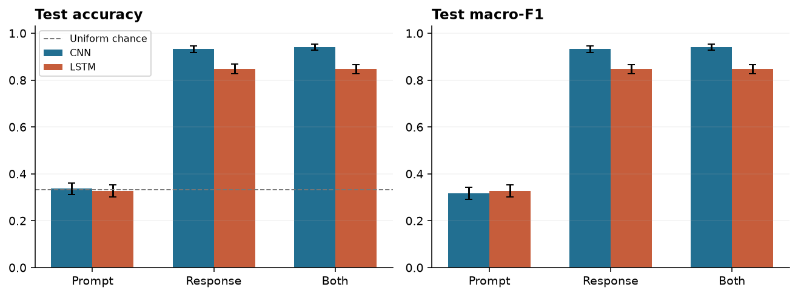
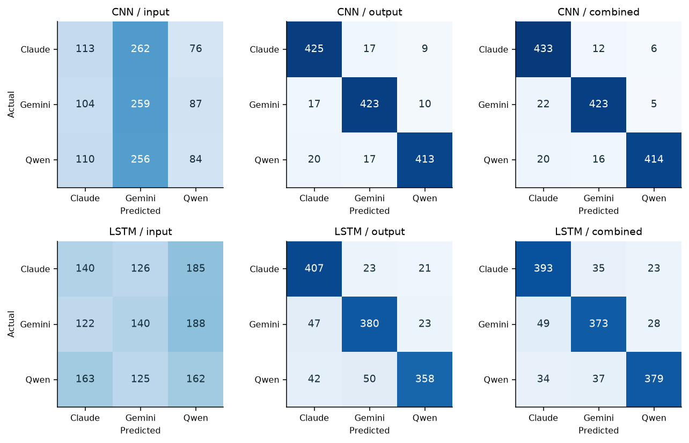
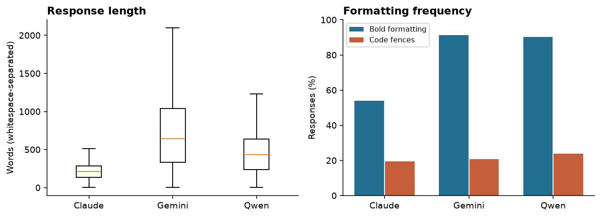
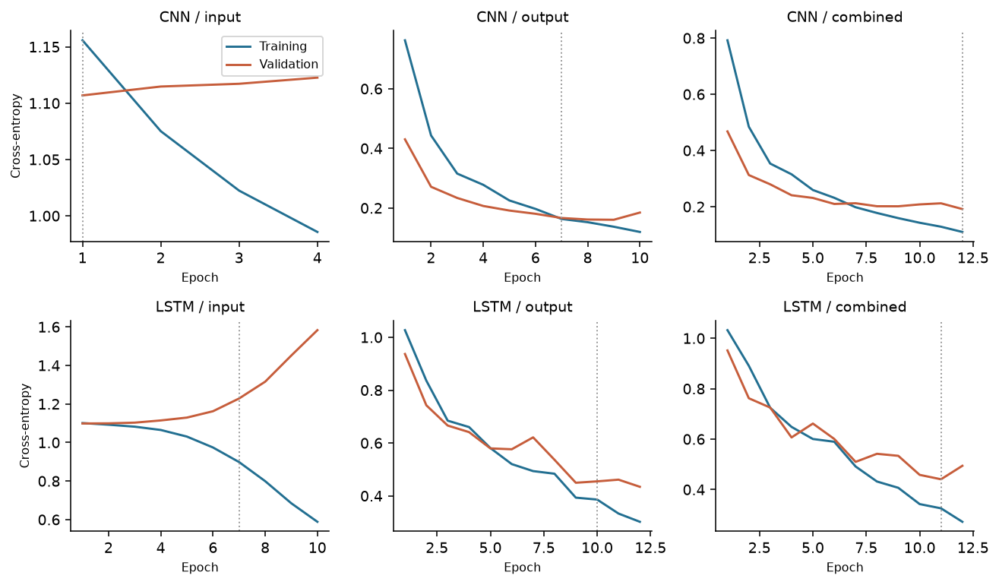

# Who Wrote It? Identifying LLMs from Their Responses

CMPSC 448  |  MIDTERM PROJECT  |  OCTOBER 2026

Identifying Claude, Gemini, and Qwen from their responses

Kevin Shook  |  Individual submission  |  2026-10-10

### Problem and principal findings

Can a classifier identify the LLM family behind a response, and does seeing the user prompt help? This study evaluates a small convolutional neural network (CNN) and a recurrent network using LSTM on 9,000 balanced examples from three model configurations. The target is the generating family, not response quality or the winner of an Arena comparison. RQ1 and RQ2 are required; RQ4 is investigated as an additional analysis.

On 1,351 held-out responses grouped to prevent exact prompt, response, and session overlap, response-only accuracy was 93.34% for the CNN and 84.75% for the LSTM. Prompt-only accuracy was near one-third. Adding prompts produced little measured benefit. Removing punctuation and newline tokens greatly reduced performance, suggesting substantial sensitivity to structural cues under this perturbation.

| Architecture | Text supplied | Accuracy | Macro-F1 | Accuracy 95% interval |
| --- | --- | --- | --- | --- |
| CNN | Prompt only | 33.75% | 0.3179 | 31.21-36.16% |
| CNN | Response only | 93.34% | 0.9334 | 91.82-94.71% |
| CNN | Prompt + response | 94.00% | 0.9401 | 92.68-95.27% |
| LSTM | Prompt only | 32.72% | 0.3272 | 30.13-35.31% |
| LSTM | Response only | 84.75% | 0.8472 | 82.75-86.74% |
| LSTM | Prompt + response | 84.75% | 0.8476 | 82.72-86.73% |

Table 1. All six required comparisons use the same split and vocabulary. Intervals use 2,000 bootstrap samples of held-out split groups; they do not capture training-seed variability.

Figure 1. Response-based models substantially exceed chance. Error bars are grouped bootstrap 95% intervals.

## Dataset curation and evaluation split

The source is Arena Human Preference 140K, containing text-only comparisons collected from April to July 2025 [1]. All seven downloaded shards contain 135,634 comparisons. Each side supplies a model name and conversation. Preference votes are discarded because they are not the target for authorship attribution. Public-source usage follows the source terms: prompts are CC-BY-4.0 and outputs are subject to their providers' terms.

| Curation stage | Count |
| --- | --- |
| Original comparisons | 135,634 |
| English, first evaluation only | 57,759 |
| Candidate responses from requested prefixes | 52,179 |
| Removed: explicit model self-identification heuristic | 366 |
| Removed: non-text or malformed content | 15 |
| Removed: duplicate model/prompt/response | 58 |
| Retained cleaned responses | 51,740 |
| Balanced modeling subset | 9,000 |

One example is the first user message and immediately following assistant response on an eligible side. Only source language "en" and evaluation_order 1 are used, avoiding later context whose models may change. Model prefixes are claude-, gemini-, and qwen; the alias qwq-32b is not included. Unicode and line endings are normalized, NUL characters removed, and outer whitespace trimmed. Internal formatting is retained. Explicit self-identification filtering is heuristic and can remove quoted statements as well as genuine self-identification.

| Family | Exact configuration | Examples |
| --- | --- | --- |
| Claude | claude-opus-4-20250514 | 3,000 |
| Gemini | gemini-2.5-flash | 3,000 |
| Qwen | qwen3-235b-a22b-no-thinking | 3,000 |

A deterministic SHA-256 ordering with seed label 448 selects 3,000 responses from each configuration. Restricting each family to one configuration avoids mixing version effects in the main comparison, but the findings do not establish attribution across every model in a family. The larger cleaned collection contains 23,996 Claude, 17,269 Gemini, and 10,475 Qwen responses.

| Partition | Claude | Gemini | Qwen | Total |
| --- | --- | --- | --- | --- |
| Train | 2099 | 2100 | 2100 | 6299 |
| Validation | 450 | 450 | 450 | 1350 |
| Test | 451 | 450 | 450 | 1351 |

Twenty stratified group folds define a fixed approximately 70/15/15 split: 14 training folds, three validation folds, and three test folds. Connected records sharing a normalized prompt, normalized exact response, or evaluation session stay together. Assertions verify no overlap in any of these identifiers. Prompt normalization for grouping is case-insensitive with collapsed whitespace; response grouping retains case. Near-duplicate paraphrases are not detected. Raw-file SHA-256 checks confirm that the source shards were not changed.

## CNN, LSTM, and training procedure

Both networks are implemented directly with PyTorch layers [2], trained from random initialization, and predict three class logits. They use only text. Model names, IDs, timestamps, labels, and category tags are excluded from inputs. Four implementation checks cover vocabulary isolation, preservation of the response budget, padding invariance, and learning a simple synthetic class signal.

| Component | CNN | LSTM |
| --- | --- | --- |
| Embedding | 20,000 x 64; padding ID 0 | 20,000 x 64; padding ID 0 |
| Text encoder | 1D convolutions: widths 3, 4, 5; 64 filters each; ReLU | One forward LSTM layer; hidden size 64 |
| Aggregation | Masked max pooling; concatenate 192 features | Hidden state at the last real token |
| Prediction | Dropout 0.3; linear 192 to 3 | Dropout 0.3; linear 64 to 3 |
| Trainable parameters | 1,329,923 | 1,313,475 |

Tokenization lowercases word tokens, keeps individual punctuation tokens, and inserts a dedicated newline token. A shared vocabulary of at most 20,000 tokens is fitted only to training prompts and responses; tokens occurring fewer than twice become unknown. No test text affects vocabulary construction. Prompt-only models receive up to 128 tokens; response-only models receive up to 256. Combined input is up to 128 prompt tokens, a separator, then up to 256 response tokens, preserving the response budget. Padding is masked in CNN pooling; the forward LSTM reads the state before padding.

Training uses AdamW (learning rate 0.001, weight decay 0.01), cross-entropy, batch size 64, and gradient norm clipping at 1.0. Maximum training is 12 epochs, with patience three on validation macro-F1 and minimum improvement 0.00001. The best validation checkpoint is restored before test evaluation. Seed 448 and deterministic PyTorch operations are used on CPU with four threads. These settings were fixed without a test-set hyperparameter search. Training and validation together for the six runs took about 4.4 minutes, excluding preparation and analysis.

| Model | Prompt best/run | Response best/run | Combined best/run |
| --- | --- | --- | --- |
| CNN | 1 / 4 | 7 / 10 | 12 / 12 |
| LSTM | 7 / 10 | 10 / 12 | 11 / 12 |

The CNN tests local token patterns at three widths and pools their strongest activations anywhere in the retained text. The LSTM updates a hidden state sequentially and classifies from the last retained token. These are compact supervised classifiers, not pretrained language models. Their different aggregation mechanisms can respond differently to introductions, punctuation patterns, and word order. Training curves and checkpoint diagnostics are provided in the appendix.

## RQ1 and RQ2: interpretation and errors

RQ1: Both models identify the generating configuration well above chance from responses. The response-only CNN achieves 93.34% accuracy and 0.9334 macro-F1; the LSTM reaches 84.75% and 0.8472. Macro-F1 averages class-wise F1 equally. A training-majority baseline predicts Qwen (tied with Gemini in training) and obtains 33.31% accuracy and 0.1666 macro-F1; uniformly random guessing has expected accuracy 33.33%.

RQ2: Prompt-only CNN and LSTM accuracies are 33.75% and 32.72%. Their uncertainty intervals include chance. Adding the prompt changes CNN accuracy by +0.67 percentage points, with a paired group-bootstrap interval of -0.30 to +1.70. For the LSTM, the change is +0.00 points. This run provides little evidence that prompts materially improve attribution. It does not show that prompt bias is absent from every dataset.

Figure 2. Held-out confusion matrices. Rows are true families and columns are predictions; cells show counts, with color normalized by row.

The output-only CNN makes 90 errors: 26 Claude, 27 Gemini, and 37 Qwen examples are misclassified. The output-only LSTM makes 206 errors, including 92 Qwen errors; its largest off-diagonal cell is Qwen predicted as Gemini (50). Similar formatting between those families is a possible explanation, examined by RQ4 rather than established by the confusion matrix alone. Prompt-only CNN predictions favor Gemini while providing essentially no useful class separation.

The models primarily see response openings: 77.0% of test responses exceed 256 tokens, while 11.4% of prompts exceed 128. This limits claims about whole-response stylistic fingerprints. A longer context window and repeated seeds would be useful follow-up experiments.

## RQ4: what distinguishes the responses?

Descriptive statistics show clear differences in length and presentation in this sample. Statistics below use all 9,000 balanced examples and the full saved responses; they were not used to choose neural hyperparameters. Type-token diversity is measured with a simple word tokenizer and depends on text length, so it should not be interpreted independently of length.

| Family | Median words | Mean words | Bold formatting | Code fences |
| --- | --- | --- | --- | --- |
| Claude | 214 | 264.0 | 53.97% | 19.40% |
| Gemini | 646 | 790.4 | 91.20% | 20.63% |
| Qwen | 434 | 462.4 | 90.23% | 23.83% |

Figure 3. Length distributions omit boxplot outlier points for readability. The underlying data are not trimmed.

Two auxiliary logistic regressions use the same training and test partitions. The length-only model uses log word count. The style model uses ten features: log word and character counts, type-token ratio, and per-word rates of lines, bold markers, code fences, headings, list lines, exclamation marks, and question marks. Standardization is fitted on training data only; C=1 and max_iter=1,000 are fixed. These classifiers see full-response information, so their scores are diagnostic and not an equal-context neural comparison.

| Diagnostic | Test accuracy | Macro-F1 |
| --- | --- | --- |
| Length-only logistic regression | 52.85% | 0.5058 |
| Style-feature logistic regression | 77.35% | 0.7734 |
| CNN, formatting tokens removed | 37.31% | 0.2566 |
| LSTM, formatting tokens removed | 39.08% | 0.2895 |

For the ablation, retain the original 256-token response window, remove punctuation and newline tokens, and evaluate the frozen response-only models. No new text is brought into the window, no model is retrained, and test results are not used to retune settings. Both models lose substantial accuracy. This demonstrates sensitivity to the perturbation, but removing tokens also changes sequence positions, length, and distribution. It does not prove that formatting alone caused the original accuracy. A stronger follow-up would retrain both models on consistently normalized text and compare performance across multiple seeds.

## Limitations, lessons, and reproducibility

### Limits of the evidence

The results concern three specific 2025 model configurations in a public Arena sample. Sampling balances labels but not topics, dates, generation settings, or response lengths. Source language and category labels are inherited and may contain errors. Exact-match grouping prevents identified leakage but not semantic near-duplicates. Model-identity filtering is incomplete and may remove benign quotations. Public conversations have not undergone a comprehensive new privacy review; raw user text is not reproduced in the report. A new domain, newer model version, or different prompting style could change accuracy. RQ3 domain transfer was not evaluated.

Only one training seed and one grouped partition were run. The reported bootstrap intervals describe test-group sampling uncertainty for these fitted models; they do not include architecture selection, training instability, or domain shift. Combined-input results and the formatting ablation should therefore be interpreted as limited comparisons, not universal claims.

### Lessons supported by this work

First, data splitting is part of the scientific question: shared prompts and repeated responses must be grouped before evaluation. Second, strong attribution can coexist with chance-level prompt-only results, so a prompt-only control helps diagnose confounding. Third, superficial presentation can be highly predictive; high accuracy alone does not establish deep linguistic differences. Fourth, validation curves reveal prompt-only overfitting that training loss would hide. Finally, reproducibility includes file formats and environment details: gzip Parquet was required for the installed R Arrow build, and equality checks confirmed that re-encoding changed no values. These are observations from the project, not claims about undocumented personal experiences.

### Reproducing and reviewing the submission

The repository includes cleaning and training scripts, R exploration, implementation tests, saved split assignments, predictions, metrics, figures, and this report. The README documents source retrieval and commands. Large raw data and local checkpoints are excluded from Git; regenerated data retain the required LLM_name, LLM_Input, and LLM_output fields. The distributed cleaned file has a recorded SHA-256 hash; an encoding note links it to the value-identical file used in training. The report is generated from saved metrics so numbers can be traced to experiment outputs.

Software: Python 3.12, PyTorch 2.14.1+cpu, NumPy 2.3.5, pandas 2.2.3, PyArrow 26.0.0, scikit-learn 1.9.1, Matplotlib 3.11.2, and ReportLab 4.4.9. R exploration was verified with R 4.6.1, Arrow 25.0.1, and data.table. Hardware: Intel Core i9-13900H, CPU training. No paid LLM API calls were used.

Assistance disclosure: Codex assisted with data cleaning, model implementation, experiment execution, verification, and report drafting. Kevin Shook is the individual author and should review and understand the submitted work, consistent with the course guidelines.

### References

[1] Arena. Arena Human Preference 140K dataset card. https://huggingface.co/datasets/lmarena-ai/arena-human-preference-140k (accessed October 10, 2026).

[2] PyTorch documentation. torch.nn.Conv1d and torch.nn.LSTM. https://docs.pytorch.org/docs/stable/nn.html

[3] scikit-learn documentation. StratifiedGroupKFold. https://scikit-learn.org/stable/modules/generated/sklearn.model_selection.StratifiedGroupKFold.html

[4] CMPSC 448. Who Wrote It? Identifying LLMs from Their Responses. Midterm project handout, modified September 17, 2026.

## Appendix: training diagnostics

Each curve shows one seeded training run. Training loss is recorded during optimization with dropout active; validation loss is evaluated with dropout disabled. The two losses therefore differ in both data and evaluation mode. Checkpoints are selected by validation macro-F1 rather than the lowest plotted validation loss, and the test set is not used for early stopping.

Figure 4. Training and validation cross-entropy over epochs. Dotted lines identify the selected checkpoints.

| Experiment | Best epoch | Validation F1 | Test F1 |
| --- | --- | --- | --- |
| cnn_output | 7 | 0.9365 | 0.9334 |
| lstm_output | 10 | 0.8585 | 0.8472 |
| cnn_input | 1 | 0.3270 | 0.3179 |
| lstm_input | 7 | 0.3528 | 0.3272 |
| cnn_combined | 12 | 0.9255 | 0.9401 |
| lstm_combined | 11 | 0.8564 | 0.8476 |

The prompt-only losses illustrate why training fit is insufficient evidence of useful attribution: training loss declines while validation loss worsens. Early stopping retains an earlier checkpoint, but the held-out results still remain near chance. The output and combined configurations learn more useful patterns. Some reach the 12-epoch ceiling, so the experiment does not establish that either architecture is optimally tuned.

Source-level checks verified unique example IDs, balanced family counts, Parquet round-trip equality, unchanged raw-file hashes, and nine independently checked prompt/response/model pairings. Split checks found no exact prompt, response, or session overlap across partitions. Checkpoint reloads were exercised by the formatting analysis. These checks address implementation and data consistency; they do not establish validity on future models or unseen domains.

